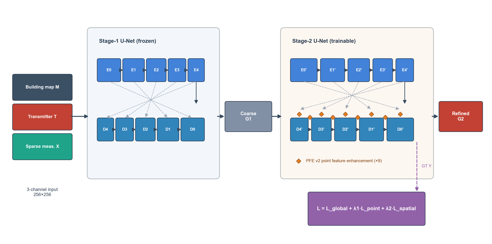
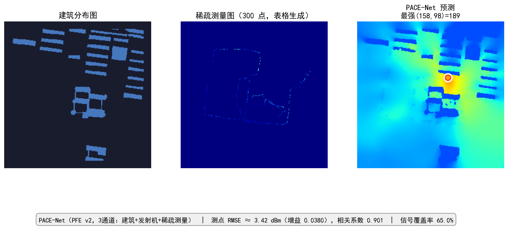

# PACE-Net: Point-Aware Conditional Enhancement Network for Radio Map Reconstruction from Sparse Observations

Official PyTorch implementation of the paper *"PACE-Net: Point-Aware
Conditional Enhancement Network for Radio Map Reconstruction from Sparse
Observations"* (submitted to **KSII Transactions on Internet and
Information Systems, TIIS**).

High-resolution radio maps must be reconstructed from extremely sparse
field measurements — on a 256×256 grid the measured pixels cover barely
0.5% of the image. These are the *only* pixels with ground-truth
anchoring, yet their contribution is diluted in global losses and smoothed
away by convolution.

**PACE-Net** is a point-aware conditional enhancement network that anchors
on measured points and radiates their information across the feature
stream:

- **PFE (Point Feature Enhancement) module** — uses the point mask and the
  measured values as a two-channel condition to drive *zero-initialized*
  gated convolutions at **nine** decoder positions. Adds only **+0.139%**
  parameters (18.4k on a 13.28M backbone) and starts as an exact identity
  mapping, so training always improves on the baseline.
- **Point-aware loss** — point weighting (with hard-example up-weighting)
  + a spatial gradient constraint on the whole-map reconstruction.
- **Two-phase training** — freezes the coarse U-Net for 80 epochs, then
  briefly fine-tunes the whole network for 20 epochs.

<p align="center">
  
</p>

## Results

On 990 RadioMapSeer test samples (99 maps × 10 transmitters, 10–300
randomly drawn sparse measurements per sample), PACE-Net attains the best
global RMSE, held-out RMSE and NMSE among **nine** methods compared in the
paper (Kriging, RBF, UNet, DeepAE, cGAN, eGAN, ACT-GAN, RME-GAN, TAN,
RadioUNet):

| Model | Point RMSE ↓ | Held-out RMSE ↓ | Global RMSE ↓ | Global NMSE ↓ |
|---|---|---|---|---|
| RadioUNet (backbone) | 0.0271 | 0.0397 | 0.0394 | 0.0286 |
| **PACE-Net (ours)** | **0.0126** | **0.0318** | **0.0316** | **0.0183** |

Relative to RadioUNet: global RMSE **−19.8%**, NMSE **−36.0%**,
measurement-point RMSE **−53.5%**, with a negligible **+0.139%** model-size
increase.

**Real-world validation.** With at most 300 field measurements collected on
a real campus (Chengdu, China), the predictions reach **0.901 correlation**
and **3.42 dBm** RMSE at the supplied measurement points — within the
5 dBm engineering margin.

## Repository layout

```
PACE-Net/
├── pace_net.py          # PACE-Net model (PointAwareWNetV2 + PFE v2)
├── modules.py           # Official RadioWNet backbone (from RadioUNet)
├── point_losses.py      # Point-aware loss + evaluation metrics
├── loaders.py           # RadioUNet_s_points dataset (from RadioUNet)
├── data.py              # Data pipeline: 501/100/99 split, 10~300 points
├── train.py             # Full two-phase training recipe
├── evaluate.py          # Reproduce the paper's test-set numbers
├── demo_campus.py       # Real-world campus demo (3 channels + CSV table)
├── demo_inputs/         # Sample campus data (map, Tx, measurements.csv)
├── weights/             # Trained checkpoints (see weights/README.md)
├── init/                # Training starting checkpoint (see weights/README.md)
└── assets/              # Figures used in this README
```

## 1. Setup

```bash
git clone https://github.com/xcljn/PACE-Net.git
cd PACE-Net
pip install -r requirements.txt
```

Download the checkpoints from the GitHub
[Releases](../../releases) page (see [weights/README.md](weights/README.md)):

- `model_best.pt` → `weights/model_best.pt` (inference & evaluation)
- `init_stage1.pt` → `init/init_stage1.pt` (only needed for re-training)

## 2. Dataset: RadioMapSeer

The [RadioMapSeer](https://ieee-dataport.org/open-access/radiomapseer)
dataset (DPM simulation) must be downloaded separately. Extract it so that
the directory layout is:

```
PACE-Net/RadioMapSeer/
├── png/buildings_complete/   # 700 building maps
├── png/antennas/             # 700×80 transmitter maps
└── gain/DPM/                 # 700×80 gain maps
```

Alternatively, set the environment variable `RADIOMAPSEER_DIR` or pass
`--data-dir` to point to the dataset location.

The 501/100/99 train/val/test map split is the deterministic standard
RadioUNet split (`np.random.seed(42)` inside `loaders.py`), and the random
sparse-point sampling is governed by the seed in `data.set_seed(20260922)`,
applied after loader construction — both are fixed, so `evaluate.py`
reproduces the paper's table **bit-exactly**.

## 3. Evaluate the trained model

```bash
python evaluate.py
```

Expected output on the full test set (990 samples):

```
point RMSE    : 0.01263   (paper: 0.0126)
held-out RMSE : 0.03178   (paper: 0.0318)
map RMSE      : 0.03157   (paper: 0.0316)
map NMSE      : 0.01829   (paper: 0.0183)
```

## 4. Real-world campus demo

A real measurement sample is included in `demo_inputs/`:

```bash
python demo_campus.py
```

This builds the sparse measurement image from `measurements.csv`
(longitude / latitude / SS-RSRP), fuses it with the building map and the
transmitter position, and writes `demo_outputs/`:
`measurements.png`, `prediction.png`, `overlay.png`, `comparison.png`
(with point RMSE in dBm and the correlation coefficient).

<p align="center">
  
</p>

To run your own scenario, replace the two PNGs and the CSV in
`demo_inputs/` (any column order; Chinese headers are auto-detected) and
adjust the four corner coordinates via `--corner-tl/--corner-tr/
--corner-bl/--corner-br` (DMS or decimal degrees).

## 5. Train from scratch

```bash
python train.py
```

- Phase 1: first-level U-Net frozen, second level trained for 80 epochs
  (Adam 1e-4, cosine schedule).
- Phase 2: full model fine-tuned for 20 epochs (Adam 2e-5).
- Loss: `L = L_global + λ1·L_point + λ2·L_spatial` (λ1=1.5, λ2=2.0) with
  hard-example point weighting (β=1, τ=0.02).
- EMA (decay 0.999); validation/model selection use the EMA weights.
- Batch 15 fits an 8 GB GPU.

Smoke test on a subset:

```bash
python train.py --epochs 2 --stage2-epochs 1 --max-train-batches 20 --max-val-batches 10
```

The exact paper run starts from `init/init_stage1.pt` (our best phase-1
checkpoint; old v1 PFE keys are ignored and the v2 modules start from
their zero-initialized identity mapping). Alternatively pass
`--baseline-weights` with the official RadioWNet_s second-level
checkpoint, or leave both out to see the strict-strict key check in
action (an explicit error message will guide you).

## Citation

If you find this work useful, please cite:

```bibtex
@article{li2026pacenet,
  title   = {PACE-Net: Point-Aware Conditional Enhancement Network for
            Radio Map Reconstruction from Sparse Observations},
  author  = {Li, Feng and Xu, Can and Liu, Junshan and Li, Linwenbo},
  journal = {KSII Transactions on Internet and Information Systems (TIIS)},
  year    = {2026},
  note    = {under review}
}
```

## Acknowledgments

This implementation builds on the
[RadioUNet](https://github.com/Rice-AML/RadioUNet) codebase and the
[RadioMapSeer](https://ieee-dataport.org/open-access/radiomapseer) dataset
by Ronneberger et al. We thank the authors for releasing their code and
data.

## License

Released under [CC BY-NC 4.0](LICENSE) for non-commercial research use.
`modules.py` and `loaders.py` are derived from RadioUNet and keep their
original license. The RadioMapSeer dataset is governed by its own license
and is **not** distributed with this repository.
